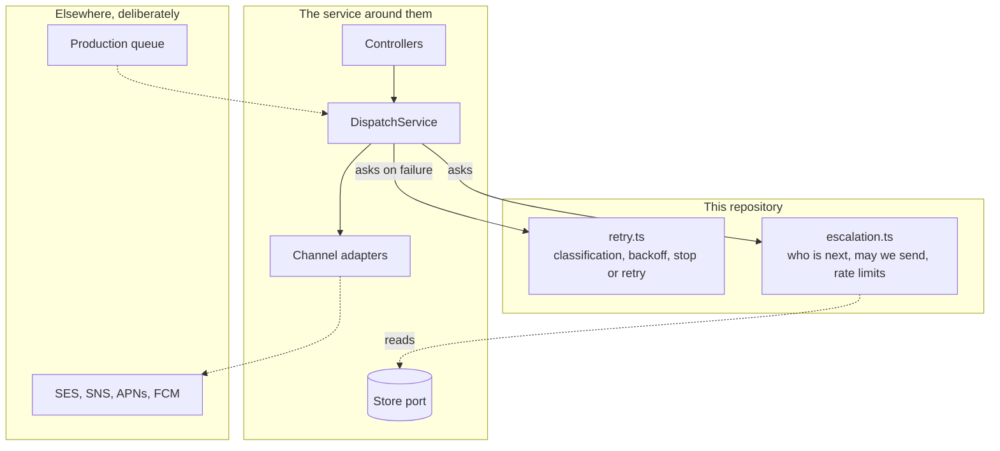

# Architecture

## Shape

A pure decision core, and a thin service around it.



The dispatcher asks two questions: *should I send this, and to whom*, and *what do I do now
that it failed*. Both answers are pure functions of state, in the green boxes. Everything
around them is transport and storage, and none of it decides anything.

## Why the decisions are separated from the doing

Delivery reliability is almost entirely about decisions made under uncertainty: is this a
duplicate, is this failure worth retrying, has this person already been reached, is it time
to escalate. Those are cheap to get subtly wrong and expensive to reproduce once they are.

Separated out, "five replays produce one delivery" is a unit test. Embedded in a worker, it
is an integration test that needs a queue, a database and a fake provider, and it will get
written once and then skipped when it turns flaky.

The service around them is thin: a NestJS module with controllers, an outbox store port and
channel adapters, none of which decide anything. It runs, and test/service.spec.ts drives
the reliability rules over real HTTP.

## The decision types

```ts
RetryDecision = { retry, delayMs, attempt } | { deadLetter, reason }
EscalationDecision = { notify, contact, step } | { wait, untilMs } | { stop, reason } | { exhausted }
SendDecision = { send: true } | { send: false, reason }
```

Discriminated unions rather than booleans with side channels. A caller has to handle every
case to compile, and `wait` carries the instant so the scheduler does not have to
recalculate it and get it slightly different.

## Where each guarantee is enforced

| Guarantee | Enforced by | Layer |
|-----------|-------------|-------|
| Business state and send-intent commit together | A transaction | Database, in the flagship |
| A message is not lost if the relay dies | Publish-then-mark ordering | Relay, in the flagship |
| A person is not messaged twice | Dedupe key checked at send time | **Here**, `shouldSend` |
| An acknowledged contact is never re-sent to | Same check | **Here** |
| A failure is retried appropriately | Classification plus backoff | **Here**, `decide` |
| Retries do not synchronise | Full jitter | **Here**, `backoffMs` |
| Escalation reaches the next person | Chain plus window | **Here**, `nextEscalationStep` |
| A replayed dead-letter is safe | Same dedupe check on the replay path | **Here** |

Six of the eight are here. The two that are not are the ones that need a database
transaction, which is exactly the boundary.

## Design decisions

**Randomness is a parameter.** `backoffMs(policy, attempt, random)`. It makes the jitter
distribution assertable at 0, 0.5 and 0.999, instead of describing it in a comment and
hoping.

**Time is a parameter.** Same reason, and it means the escalation tests run instantly
rather than waiting out three-minute windows.

**Contact carries no address.** An identifier, a priority and a channel. The address is
resolved by the sender at the moment of sending. This layer is the part most likely to end
up in a log line or a debugger, so there is nothing sensitive in it to leak.

**Dedupe at send time, not schedule time.** The single most important ordering decision
here, and the reason a manual replay of a dead-lettered message is safe.

**A dead-lettered delivery counts as contacted.** The escalation chain moves on rather than
stalling. Retrying that delivery belongs to the retry loop, not the chain.

## What a host has to provide

| Responsibility | Why not here |
|----------------|--------------|
| The outbox transaction | Needs a database. The store port is here; the transactional write is in the flagship |
| A production queue | The in-memory outbox here is the same interface |
| Sending to a real provider | Needs credentials, which this repository must never hold. The adapter interface is here; SES, SNS, APNs and FCM implementations are in the flagship |
| Persisting delivery records | Needs a database |
| Scheduling the escalation sweep | Needs a scheduler |

## At ten times the volume

- Move the relay out of the API process, so a slow provider does not compete with request
  handling for the event loop
- Partition delivery records by month; they are append-heavy and queried by recent range
- Per-provider circuit breakers, so a failing provider is skipped rather than retried into
- Webhook delivery receipts, to close the gap between provider acceptance and actual
  delivery
