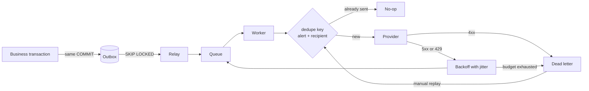

# croppulse-alert-engine

**Getting a crop alert to the person who can act on it, reliably, exactly once as far as
they can tell, when the provider is down and the queue delivers twice.**

> A demonstration, not a service anybody runs a farm on.

> **A reconstruction, not an employer's codebase.** Crop monitoring produces alerts nobody
> is sitting waiting for: a soil moisture reading crosses a threshold at four in the
> morning and somebody has to be told, once, on a channel they will actually see. That is
> the problem I worked on in agriculture between 2018 and 2023, and it is the problem this
> repository takes apart. The code, the tests and the wording are all written from scratch
> for the portfolio.

[](docs/test-results/)
[](LICENSE)

---

## The problem

A crop alert is worth nothing if it does not reach somebody. Sending an email is easy;
everything after that is not:

- The queue delivers at least once, so a worker sees the same message twice as a matter of
  routine, not as an error.
- A worker can crash after sending and before recording that it sent.
- Providers go down, rate limit, and occasionally accept a message and drop it.
- A retry storm during an outage hits the recovering provider with the whole backlog at
  once, turning a brief outage into a long one.
- An agronomist replaying a dead-lettered message must not wake a grower a second time.
- A recipient who has already replied must not receive the escalation that was queued a
  second before they did.

Every one of those has a mechanism here, and a test named after the failure it prevents.

## The design



### Transactional outbox

Business state and the intent to send commit together. The relay publishes afterwards and
can fail and retry without losing the message. It cannot publish for a transaction that
rolled back, and a committed transaction cannot end up with no message queued.

### Deduplication where it matters

The dedupe key is alert plus recipient, and it is checked **immediately before sending**,
not when the message is scheduled. That ordering is the whole point: a message can sit on a
queue for minutes, and the recipient may have acknowledged meanwhile.

This is what makes at-least-once queue delivery invisible to the person receiving the
message, and what makes replaying a dead-lettered message safe. A test sends the same
message five times and asserts one delivery.

### Retry with jitter

Exponential backoff, capped at ten minutes, with **full jitter** by default.

Jitter is not an optimisation. Without it, every message that failed during one outage
retries at the same instant and the recovering provider gets the entire backlog in a
spike. Randomness is injected rather than taken from `Math.random()`, so the schedule is
asserted in tests instead of described in a comment.

### Failure classification

| Response | Class | Behaviour |
|----------|-------|-----------|
| 5xx, 408, 425 | transient | Retry with backoff |
| 429 | throttled | Honour `Retry-After`, capped at the ceiling |
| Other 4xx | permanent | Dead-letter immediately, no retries |

Getting this wrong costs in both directions. Treating a transient failure as permanent
loses a message that would have gone through. Treating a permanent one as transient burns
five attempts on an address that does not exist and delays the dead-letter that would have
told somebody the recipient details are wrong.

### Escalation

Notify the primary recipient. If nobody acknowledges within the window, bring in the next
one. Stop the moment anybody answers.

Three details that took thought:

- **The window runs from the last send, not from the alert.** A slow first delivery must
  not eat the time the primary recipient actually had.
- **Any acknowledgement stops the chain**, from anyone. The point is to reach somebody, and
  somebody has been reached.
- **A dead-lettered delivery counts as contacted.** Retrying it is the retry loop's job;
  the chain should move on rather than stall waiting for a message that will not arrive.

There is a step limit, so a holding with twenty recipients does not wake all of them at 3am.

### Per-recipient rate limiting

Separate from the API rate limit and aimed at a different failure: a bug, or a genuine
burst of alerts, becoming a stream of messages to one person's phone. A cap per
recipient per hour bounds the worst case regardless of the cause.

## Running it

```bash
pnpm install
pnpm verify        # lint, type-check, 58 tests
pnpm dev           # http://localhost:3003
```

Nothing external. Time and randomness are injected, so backoff schedules and escalation
windows are asserted directly rather than waited out.

`docker compose up -d` starts Postgres and Redis for driving it against real backing stores.

## Test coverage

58 tests, all passing: 44 unit tests over the decision logic and 14 that drive the same
rules over real HTTP against the running service.

| Area | Cases |
|------|-------|
| Backoff | Exponential growth, ceiling, full jitter spread, equal jitter floor, zero before first retry |
| Classification | Ten status codes across all three classes |
| Retry decisions | Transient retried, permanent never retried, budget exhaustion, `Retry-After` honoured and capped, full walk to dead-letter |
| Deduplication | First send, repeat suppressed, in-flight suppressed, dead-letter replay allowed, acknowledged never re-sent, per-alert scoping, five replays produce one delivery |
| Escalation | Immediate primary, window wait, escalation on silence, window measured from last send, stop on acknowledgement from anyone, step limit, no recipients, dead-lettered counts as contacted, priority order, full chain |
| Rate limiting | Under cap, at cap, aged-out sends ignored |
| Over HTTP | Escalation chain end to end, repeated drains sending once, retry then success, permanent failure dead-lettered immediately, dead-letter listing and safe replay, acknowledgement suppressing a replay, delivery endpoint exposing no recipient details |

Recorded output: [docs/test-results/](docs/test-results/).

## Deliberately not here

Sensors, readings, thresholds, maps, mobile apps, agronomist UI. This service takes a
request and reports
an outcome; recipients are opaque identifiers. If it is not about delivery reliability, it
does not belong.

## Known limitations

- **No real provider is called.** The adapter interface is here with a mock implementation;
  SES, SNS, APNs and FCM implementations are in the flagship and none has ever been
  exercised against a live account. No delivery-rate figure appears anywhere here.
- **No published performance numbers.** A load script exists. Running it against mock
  providers would measure the mock, so no throughput figure is claimed.
- **Escalation is time-based, not adaptive.** A fixed window per step. A real product would
  tune this per recipient and per time of day.
- **The outbox relay is polling, not listening.** `LISTEN`/`NOTIFY` would cut latency; at
  a two-second poll interval it has not been worth it.
- **No template rendering engine.** Templates are versioned and a delivery records which
  version produced it; the renderer itself is a string interpolation.

## Further reading

[docs/RELIABILITY.md](docs/RELIABILITY.md) covers the delivery guarantees, what "exactly
once" actually means here, and where the guarantees stop.

## Suggested repository metadata

**Description:** Notification and escalation service: transactional outbox, idempotency,
jittered retries, dead-letter replay and provider failover, with tests for every failure
mode.

**Topics:** `typescript` `reliability` `outbox-pattern` `idempotency` `retry` `dead-letter`
`distributed-systems` `observability` `portfolio`

## Licence

[MIT](LICENSE).
