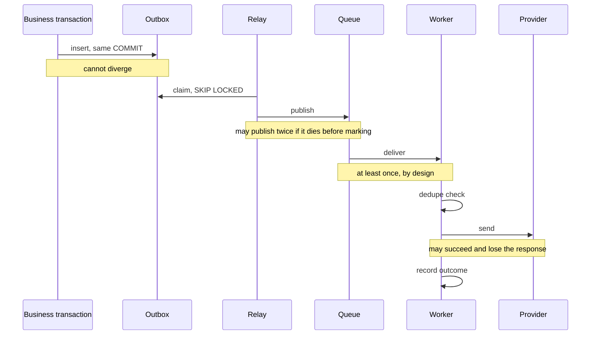

# Delivery guarantees

What this system actually promises, how it delivers on it, and where the promise stops.

## The claim, stated precisely

**At-least-once delivery to the provider, and at-most-once from the point of view of the
person receiving the message.**

That is not "exactly once", and the distinction is the whole design. Exactly-once delivery
across a network boundary is not achievable. What is achievable is at-least-once delivery
with an idempotent consumer, which produces the same observable outcome for the human at
the end of it.

## The chain, and where each part can fail



### Business transaction to outbox

**Guarantee: exact.** Same transaction, same commit. There is no interleaving in which the
incident exists and the message does not, or the reverse.

This is the single most valuable property in the chain, and it is why the outbox exists
rather than publishing directly from the request handler. A user who triggered SOS believes
help is coming; an incident with no notification queued produces confidence with nothing
behind it.

### Outbox to queue

**Guarantee: at least once.** The relay can publish and then die before marking the row
sent, so the next pass publishes again. That is deliberate: the alternative ordering, mark
then publish, loses messages instead of duplicating them, and losing one here is much worse.

`SELECT ... FOR UPDATE SKIP LOCKED` lets several relays run without blocking each other or
claiming the same row.

### Queue to worker

**Guarantee: at least once.** SQS is at-least-once and no configuration changes that.
Visibility timeout reduces the window; it does not close it.

### Worker to provider

**Guarantee: at least once, with an idempotent consumer in front of it.**

The dedupe key is incident plus contact. It is checked immediately before sending, not
when the message is scheduled, because a message can wait on a queue for minutes and the
recipient may have acknowledged in that time.

The residual window is real and worth naming: the worker can send successfully and die
before recording it. The next attempt sees no record and sends again. Closing that would
need a distributed transaction with the provider, which providers do not offer. The window
is milliseconds wide and the failure mode is one duplicate message, which is the correct
side to fail on for a safety alert.

## Idempotency, layer by layer

| Layer | Key | Scope |
|-------|-----|-------|
| API request | `Idempotency-Key` header | Per subject and route, 24 hours |
| Incident activation | Unique index on `(user_id, key)` | For ever |
| Notification delivery | `incident_id:contact_id` | Per incident |
| Escalation step | Contact already in the delivery set | Per incident |

Four layers because each covers a case the others do not. The API key covers a client
retry. The unique index covers two concurrent retries that both miss the lookup. The
delivery key covers queue redelivery and manual replay. The escalation check covers the
scheduler running twice.

## Retries

Full jitter by default:

```
delay = random(0, min(base * 2^(attempt-1), ceiling))
```

Without jitter, every message that failed during one outage retries at the same instant.
The recovering provider gets the whole backlog in a spike and falls over again, and the
outage lasts longer than the original fault.

Randomness is injected, so the schedule is asserted in tests rather than described.

Permanent failures are not retried at all. Five attempts at an address that does not exist
burns the budget and delays the dead-letter that would have told somebody the contact
details are wrong.

## Dead letters

After the attempt budget, or immediately on a permanent failure, the message is moved to
the dead-letter queue **with its failure history**. Not dropped, not retried for ever.

Replay is manual and deliberate. It is safe because the dedupe check runs on the replay
path exactly as it does on the first attempt, and it stops entirely if the contact has
acknowledged in the meantime. Both have tests.

A non-empty dead-letter queue is one of only two alarms in this portfolio that would wake
somebody. A notification that was permanently undeliverable means an alert did not reach
the person it was raised for, which is the only failure here that matters to a human rather
than to a dashboard.

## Ordering

**There is no ordering guarantee, and none is needed.**

Notifications to different contacts are independent. Notifications to the same contact for
the same incident are deduplicated to one. Escalation ordering is enforced by the decision
function, which reads current state rather than assuming messages arrive in the order they
were scheduled.

Stating this explicitly matters: a system that quietly depends on queue ordering works
until the day the queue reorders, and then fails in a way that is very hard to diagnose.

## What is not guaranteed

- **That the provider actually delivered.** Provider acceptance is not delivery. Webhook
  status updates would narrow the gap; they are not implemented.
- **Latency.** No SLA is claimed. Nothing has been measured against a real provider, so no
  number appears anywhere in this repository.
- **Ordering between contacts.** As above, by design.
- **Delivery when every provider is down.** Failover switches between configured providers.
  If all of them are unavailable, messages accumulate in the queue and the backlog alarm
  fires. There is no fallback that does not involve a provider.

## Observability

Every message carries a correlation id from the originating request through the outbox,
the queue, the worker, the provider call and every log line. One search reconstructs the
whole path.

Metrics that would matter in a deployment: outbox depth, dead-letter depth, attempts per
delivery, time from incident activation to first successful send, and acknowledgement rate
per contact position. Only the first two are wired to alarms, because the rest are
diagnostic rather than actionable.
